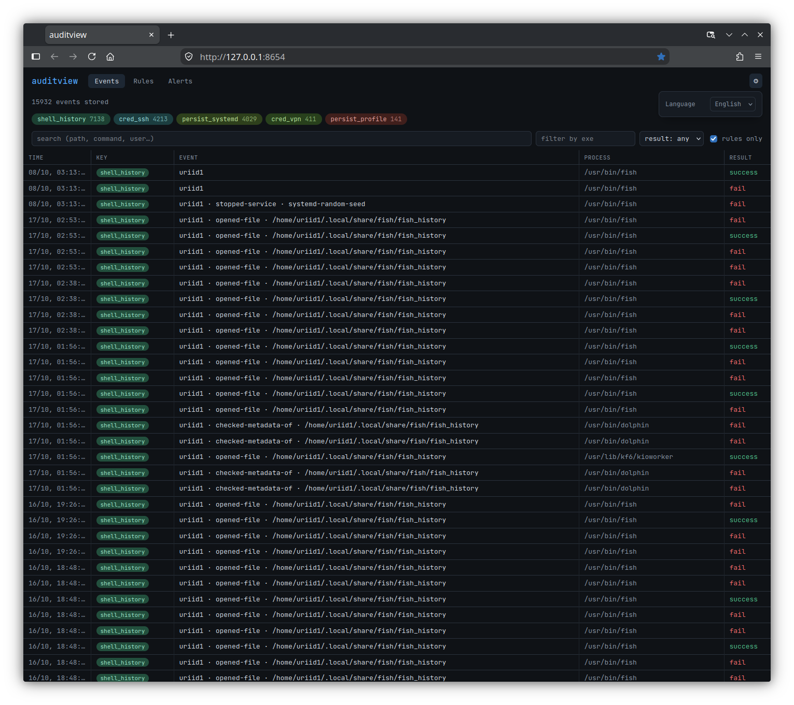

# auditview

English documentation: [README.md](README.md).

Локальный веб-интерфейс для просмотра логов auditd. Один бинарник:
Go-бэкенд парсит `/var/log/audit/audit.log` (через elastic/go-libaudit —
склейка многострочных событий, резолв uid/syscall), Svelte-фронтенд
встроен через `embed.FS`.



## Возможности

- Живой хвост логов (SSE) с паузой
- Фильтры: ключ правила (`-k`), exe, результат, текстовый поиск
- Чипы по ключам с количеством событий
- Раскрытие события: процесс, пользователь, syscall, затронутые файлы,
  сырые записи
- Читает и ротированные `audit.log.1..N` при старте
- Редактор правил `/etc/audit/rules.d`: конструктор, режим эксперта,
  проверка синтаксиса, применение через `augenrules --load`
- Алертинг по живым событиям: рабочий стол, Telegram, своя команда

Язык интерфейса — английский по умолчанию, русский выбирается в меню ⚙.

## Сборка

```sh
cd web && npm install && npm run build && cd ..
go build -o auditview ./cmd/auditview
```

## Запуск

Чтение `/var/log/audit` требует root:

```sh
sudo ./auditview
# → http://127.0.0.1:8654
```

Флаги: `-log` (путь к audit.log), `-addr` (по умолчанию `127.0.0.1:8654`
— не выставляйте наружу: интерфейс без аутентификации), `-rotated`,
`-keyless` (хранить и события без ключа правила — BPF, сервисы systemd
и т.п.; по умолчанию отбрасываются на входе), `-rules-dir` (каталог
rules.d, пустое значение отключает редактор), `-db` (SQLite, по
умолчанию `/var/lib/auditview/auditview.db`), `-retain` (дней истории,
по умолчанию 90), `-alerts` (конфиг алертинга, по умолчанию
`/etc/auditview/alerts.json`).

## Хранение

События пишутся в SQLite (чистый Go-драйвер, без cgo): история
переживает перезапуски, при старте бэкфил из audit.log дедуплицируется
по (ts, seq). Старше `-retain` дней — удаляются раз в сутки.

## Алертинг

Конфиг `/etc/auditview/alerts.json` создаётся при первом запуске:
правила по ключам (cred_*, persist_* включены, shell_history выключен)
с кулдауном на пару правило+exe. Каналы:

- `desktop` — notify-send в сессию пользователя (user берётся из
  SUDO_USER при создании конфига)
- `telegram` — token + chat_id
- `command` — свой скрипт; данные в env `AV_TITLE`, `AV_BODY`

Алерты срабатывают только на живые события: исторический бэкфил при
старте не алертит. Вкладка «Алерты» — журнал срабатываний со статусом
доставки и тестовой кнопкой.

## Автозапуск (systemd)

```sh
sudo cp auditview /usr/local/bin/
sudo cp contrib/auditview.service /etc/systemd/system/
sudo systemctl daemon-reload
sudo systemctl enable --now auditview
```

После пересборки заменяйте бинарник атомарно (обычный `cp` поверх
запущенного файла падает с «Текстовый файл занят»):

```sh
sudo cp auditview /usr/local/bin/auditview.new \
  && sudo mv /usr/local/bin/auditview.new /usr/local/bin/auditview \
  && sudo systemctl restart auditview
```

## Разработка

```sh
sudo ./auditview &          # API на :8654
cd web && npm run dev       # Vite dev-сервер с прокси на /api
```

## Редактор правил (вкладка «Правила»)

- Показывает все `*.rules` из `/etc/audit/rules.d` (порядок = порядок
  склейки augenrules), строки размечаются чипами (never/perm/key)
- Правка построчно, валидация поддерживаемого синтаксиса при сохранении,
  прежняя версия остаётся рядом как `<файл>.bak`
- Конструктор для типовых правил: «следить» (watch/dir) и «исключить шум»
  (never по exe) — генерирует строку, остаётся только сохранить
- «Применить правила» (двойной клик для подтверждения) = `augenrules
  --load`; после — вывод, список загруженных правил, `auditctl -s`
- Статус-бар: аудит включён/выключен, счётчик lost, синхронизированы ли
  файлы с ядром (`augenrules --check`)
- Флаг `-rules-dir` меняет каталог (пустое значение отключает редактор);
  применение/статус всегда работают с системным auditd
